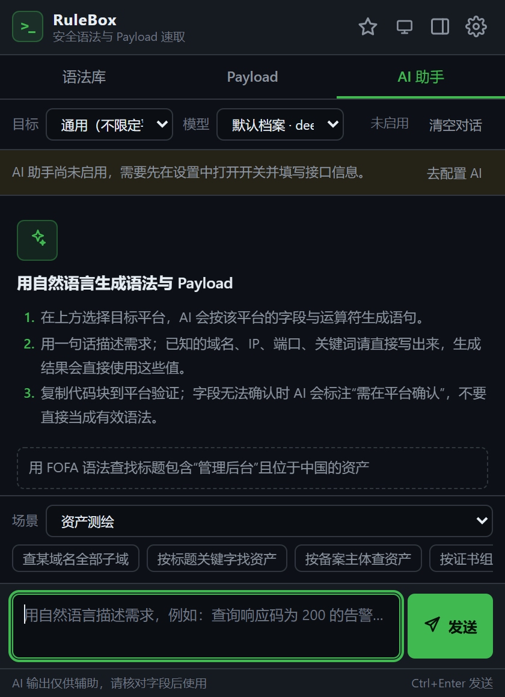
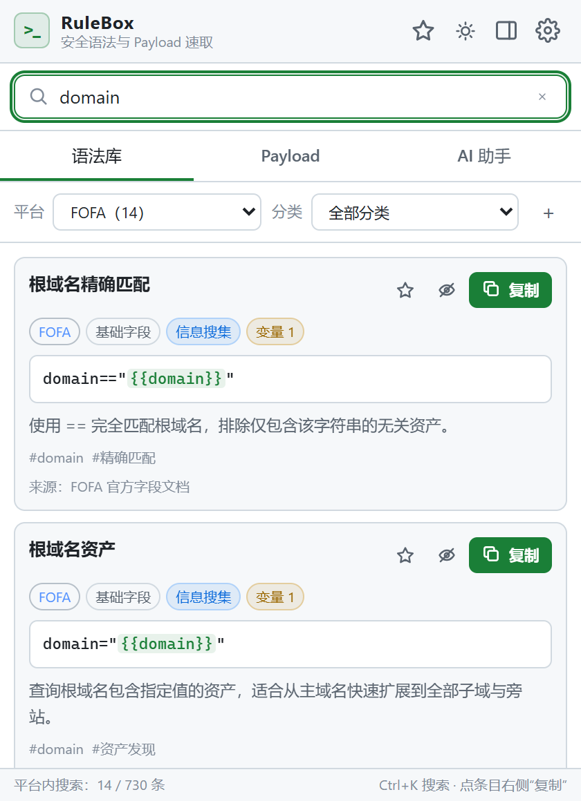
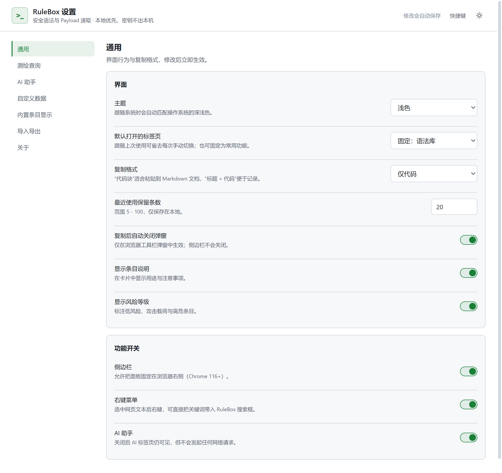

# RuleBox · 安全语法与 Payload 速取

<div align="center">


**面向网络安全工程师的浏览器速取面板** — 测绘语法、漏洞 Payload、AI 助手，三者合一，一键复制。

</div>

---

## ✨ 这是什么？

做安全的都懂：`domain="example.com" && title="后台"` 这种 FOFA 语法、`' AND IF(1=1, SLEEP(5), 0) --` 这种 SQL Payload，每次做测试都在脑子里记、浏览器里搜。

**RuleBox 把这些变成了一个可搜索、可筛选、可变量填充的面板** — 装到 Chrome / Edge 里，按一下快捷键就弹出来，搜一下、填变量、点复制，直接粘到测试工具里。

- 🗂️ **11 个测绘平台**：FOFA / Hunter / Quake / ZoomEye / Shodan / Alpha / DayDayMap / 0.zone / Google / Baidu / 工具命令
- 💣 **19 类漏洞 Payload**：SQLi / XSS / SSRF / RCE / LFI / XXE / SSTI / Deserialization / JWT / NoSQL / LDAP / CRLF / Redirect / Upload / JNDI / Shell / Webshell / Sensitive / WAF
- 🤖 **AI 助手**（可选）：自然语言生成定制语法，支持 DeepSeek / 通义 / Kimi / 智谱 / OpenAI / Ollama 本地

---

## 🖼️ 界面预览

**深色主题**（默认）

<p align="center">
  
  
</p>

<p align="center">
  
</p>

<details>
<summary><b>浅色主题预览</b>（点击展开）</summary>

<br>

<p align="center">
  
  
</p>

<p align="center">
  
</p>

</details>

> 主题可在设置页切换：跟随系统 / 深色 / 浅色；也可点击面板右上角的主题按钮快速切换。

---

## 🚀 快速安装

本项目是标准的 Manifest V3 扩展，**无需构建、无需打包**，直接加载源码目录即可。

### Chrome

1. 打开 `chrome://extensions/`
2. 右上角打开「开发者模式」
3. 点击「加载已解压的扩展程序」，选择本项目根目录
4. 工具栏出现 RuleBox 图标即安装成功

### Edge

1. 打开 `edge://extensions/`
2. 打开「开发人员模式」
3. 点击「加载解压缩的扩展」，选择本项目根目录
4. 工具栏出现 RuleBox 图标即安装成功

> Edge 与 Chrome 扩展的存储互不共用 — 同一份源码可以同时装进两个浏览器，设置、收藏、最近使用按浏览器隔离。

---

## ⌨️ 快捷键

| 快捷键 | 功能 |
| :--- | :--- |
| `Ctrl+Shift+Y` / `Cmd+Shift+Y` | 打开 RuleBox 面板 |
| `Ctrl+K` / `Cmd+K` | 聚焦搜索框 |
| `Ctrl+1` / `2` / `3` | 切换 语法库 / Payload / AI 助手 |
| `Ctrl+Enter` | AI 输入框内发送请求 |
| `Escape` | 清空搜索 / 关闭弹窗 |

---

## 🧭 功能一览

### 语法库 / Payload 库

- **多维筛选**：平台 → 分类 → 关键词，三级组合快速定位
- **变量填充**：`{{domain}}`、`{{ip}}`、`{{target}}` 这类占位符复制时弹窗填写，填过的值自动记忆
- **复制格式**：仅代码 / Markdown 代码块 / 标题 + 代码，设置页一键切换
- **收藏 / 最近使用**：高频条目收藏后只看收藏；最近 20 条自动记录
- **隐藏内置条目**：暂时用不到的点眼睛图标隐藏，不删除任何数据；设置页可恢复
- **自定义条目**：自己加的语法和 Payload，跟内置的一样用
- **右键搜索**：选中网页文本后右键「在 RuleBox 中搜索」，关键词直接带入
- **侧边栏模式**：Chrome 116+ / Edge 116+ 固定常驻，弹窗模式同时保留

### AI 助手

- **自然语言生成**：「查询响应码为 200 的告警」→ 直接生成完整语法
- **多供应商**：预设 DeepSeek / 通义千问 / Kimi / 智谱 GLM / OpenAI / Ollama（本地），也支持任意 OpenAI 兼容端点
- **流式输出**：token 一个接一个出，不用等整批
- **本地召回示例**：请求前从库内检索最相关的少量条目作为参考，让生成风格贴近库内写法；不上传全库
- **安全**：API Key 仅保存在本地 `chrome.storage.local`，导出配置时自动剔除；请求有域名授权、每日限额、最小间隔三重防护
- **错误即时提示**：额度不足、鉴权失败、限流等在对话里直接显示原因

### 深色终端风主题

- 深色 / 浅色 / 跟随系统三档
- 无渐变、无花哨装饰，信息密度高、长时间看不累
- 原生控件（下拉框等）随主题着色，深浅一致

---

## 🤖 AI 配置（可选）

1. 打开面板右上角「设置」→「AI 助手」
2. 打开「启用 AI 助手」总开关
3. 选择供应商（预设 7 家，也可自定义），填入 API Key
4. 非内置域名端点首次使用需点击「授权域名」
5. 可调：模型、温度、超时、流式、历史条数、每日限额、系统提示词等

**接口异常时**：对话里立即显示错误原因与控制台入口；错误只在本机展示，不写入记录、不上传、不推送。

---

## 🤝 帮助、反馈与贡献

- **遇到问题**：在仓库的 Issues 里提交，尽量附上浏览器与扩展版本、复现步骤、控制台报错
- **想加语法 / Payload**：可以直接在设置页「自定义数据」里新增，随加随用；也可以提 PR 改 `src/data/` 下的 JSON（开发约定见 [docs/DEVELOPMENT.md](docs/DEVELOPMENT.md)）
- **提交代码前**：请先读 [DEVELOPMENT.md](docs/DEVELOPMENT.md)，保持无构建、纯原生 ES Module 的结构，不要在代码或数据里写入真实密码、Key、真实单位与个人的信息
- **维护者**：由 RuleBox 维护者与贡献者共同维护

---

## 📖 数据来源与免责声明

- 语法与字段依据各平台**公开文档**与公开技术资料整理，条目内标注 `source` 来源
- Alpha 态势感知为私有部署产品，字段参考通用模式整理，不同版本可能存在差异，示例值均为**通用占位**
- 本插件仅提供语法与 Payload 的速查复制能力，所有内容仅供**已授权的安全测试与防御研究**使用。使用者在未授权目标上使用相关内容所产生的一切后果自行承担。

---

## 🗂️ 目录结构

```
RuleBox/
├─ manifest.json              # MV3 清单
├─ LICENSE                    # MIT 开源协议
├─ icons/                     # 扩展图标（16/32/48/128）
├─ assets/                    # README 截图与图片
├─ src/
│  ├─ background/             # Service Worker（右键菜单 / 侧边栏）
│  ├─ core/                   # 核心逻辑（存储、数据、AI、搜索、模板…）
│  ├─ data/                   # 内置 JSON 数据（平台 / 语法 / Payload / 提示词）
│  ├─ options/                # 设置页（HTML/CSS）
│  ├─ popup/                  # 弹窗（HTML/CSS）
│  ├─ shared/                 # 设计令牌与基础样式
│  └─ ui/                     # 界面逻辑（面板 / 设置页 / 组件库）
└─ docs/DEVELOPMENT.md        # 开发与维护文档
```

---

## 📜 License

本项目基于 [MIT License](LICENSE) 开源。
