# RuleBox · 安全语法与 Payload 速取

<div align="center">

       

**面向网络安全工程师的浏览器速取面板** — 测绘语法、安全测试 Payload、聚合查询、AI 助手，四者合一，一键复制。

<sub>RuleBox — a local-first browser panel for security recon syntax, payloads, and AI-assisted query generation.</sub>

</div>

---

> 如果 RuleBox 对你有帮助，欢迎点一个 Star；发现语法过期或有更好的写法，欢迎提 Issue / PR。

---

## ✨ 这是什么？

做安全的都懂：`domain="example.com" && title="后台"` 这种 FOFA 语法、`' AND IF(1=1, SLEEP(5), 0) --` 这种 SQL Payload，每次做测试都在脑子里记、浏览器里搜。

**RuleBox 把这些变成了一个可搜索、可筛选、可变量填充的面板** — 装到 Chrome / Edge 里，按一下快捷键就弹出来，搜一下、填变量、点复制，直接粘到测试工具里。

- 🗂️ **17 个语法库**：13 个测绘与态势平台（FOFA / Hunter / Quake / ZoomEye / Shodan / DayDayMap / 0.zone / 奇安信天眼 / 安恒 AiLPHA / 华为云安全云脑 / 深信服 SIP / 长亭全悉 T-Answer / 新华三 SecCenter CSAP）+ Google / 百度 + 常用命令行工具 + Wireshark 显示过滤
- 💣 **19 类安全测试 Payload / 267 条**：SQLi / XSS / SSRF / RCE / LFI / XXE / SSTI / Deserialization / JWT / NoSQL / LDAP / CRLF / Redirect / Upload / JNDI / Shell / Webshell / Sensitive / WAF
- 🔎 **测绘聚合查询**：填入 FOFA / Hunter 鹰图 / Quake / ZoomEye / Shodan / DayDayMap / 0.zone 的 API Key 后，在面板内用同一语法并行检索多个平台，结果可跳转、可复制、可翻页、可导出
- 🤖 **AI 助手**（可选）：6 家预设 + 任意 OpenAI 兼容端点，自然语言生成定制语法与 Payload

目前内置 **963 条语法、267 条 Payload、20 条 AI 提示词**，全部可搜索、可筛选、可收藏。

### v2.1 新增

- **Wireshark 显示过滤语法库**：新增 161 条显示过滤表达式，覆盖比较与逻辑组合、地址与端口、TCP 排障、HTTP / DNS / DHCP / ARP、TLS 与证书、邮件与文件传输、性能分析等场景，复制后粘贴到过滤器栏即可筛选报文

### v2.0 新增

- **聚合查询**：面板内直接查询 7 家测绘平台，支持单选 / 多选、分页、结果快照恢复
- **多格式导出**：聚合结果一键导出为 JSON / CSV / Markdown / TXT
- **默认打开方式**：可跟随上次使用的标签页（默认），也可固定为指定标签页
- **设置更稳**：修复了部分操作会把整份配置重置为默认值的问题，密钥不会再被误清空

---

<a id="preview"></a>

## 🖼️ 界面预览

以下均为深色主题（默认）。

<br>

### 演示：四个标签页

语法库 → Payload 库 → 聚合查询 → AI 助手，一键切换。

<p align="center">
  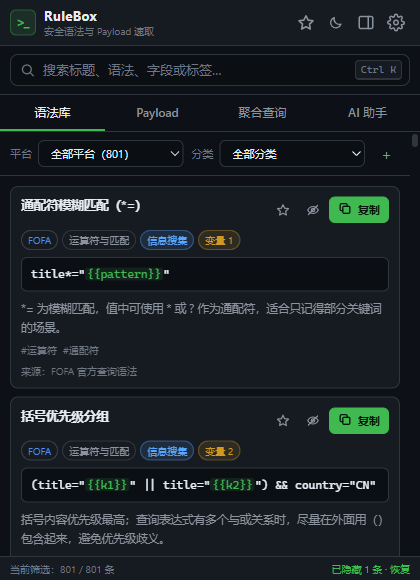
</p>

<table align="center">
  <tr>
    <td align="center">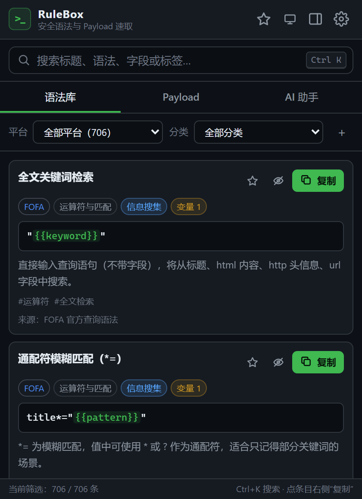<br><sub>语法库</sub></td>
    <td align="center">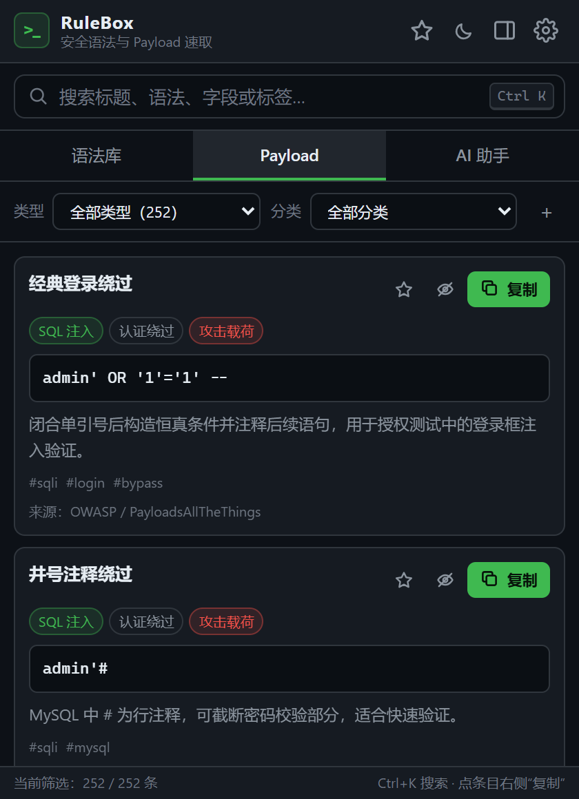<br><sub>Payload 库</sub></td>
  </tr>
  <tr>
    <td align="center">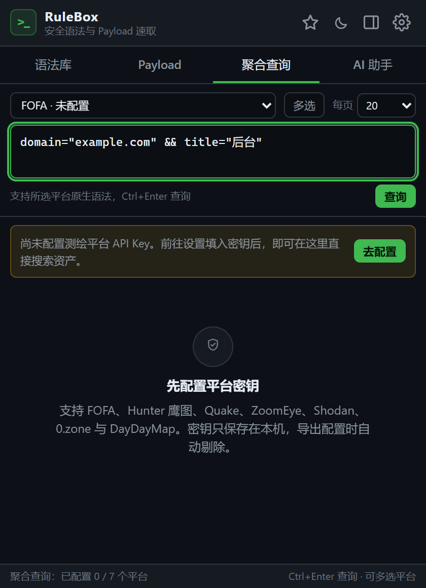<br><sub>聚合查询</sub></td>
    <td align="center"><br><sub>AI 助手</sub></td>
  </tr>
</table>

<br>

### 语法库

按平台归类，支持关键词搜索与分类筛选，卡片内直接显示语法与说明。

<p align="center">
  
</p>

<br>

### Payload 库

按 Payload 类型分组，可按分类过滤，列表可连续滚动浏览全部条目。

<p align="center">
  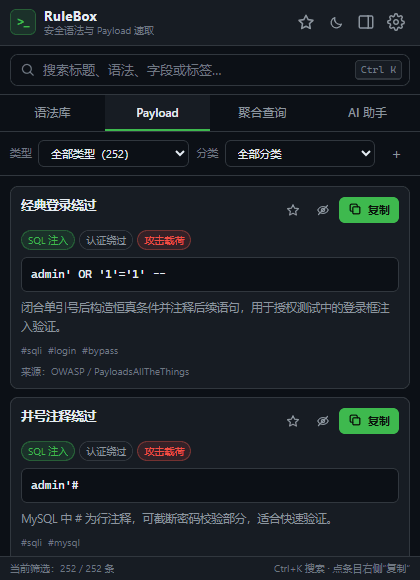
</p>

<p align="center">
  
</p>

<br>

### 聚合查询

一条语法 `domain="example.com"`，同时检索已配置密钥的多个平台，结果可复制、可导出、可翻页。

<p align="center">
  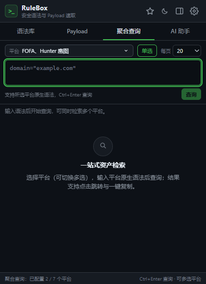
</p>

<p align="center">
  
</p>

<br>

### 变量填充

搜索语法 → 点复制 → 填写 `example.com` → 预览确认 → 一键复制；带变量的条目会弹出填写框，下方实时预览填充后的最终语句。

<p align="center">
  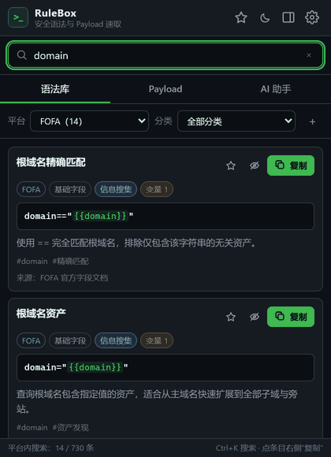
</p>

<p align="center">
  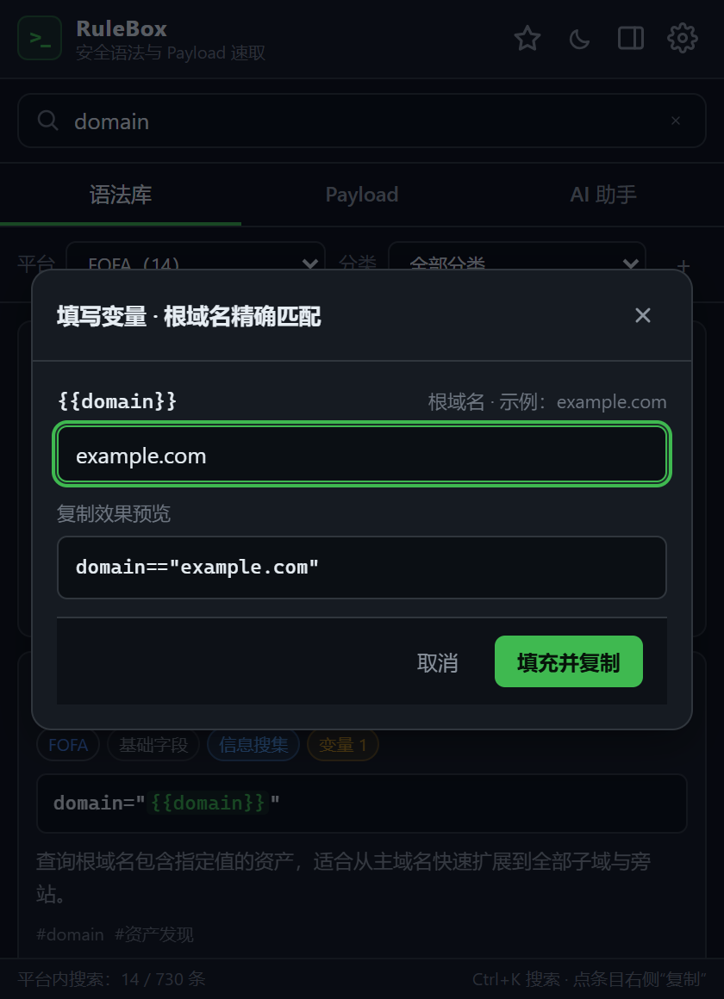
</p>

<br>

### AI 助手

内置平台上下文与提示词库，用自然语言描述需求即可生成语法或 Payload，回复中的代码块可直接复制。

<p align="center">
  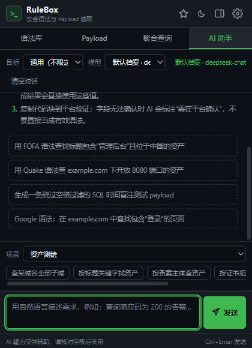
</p>

<p align="center">
  
</p>

<br>

### 设置页

主题、复制格式、默认标签页、AI 档案、数据导入导出与自定义条目管理。

<p align="center">
  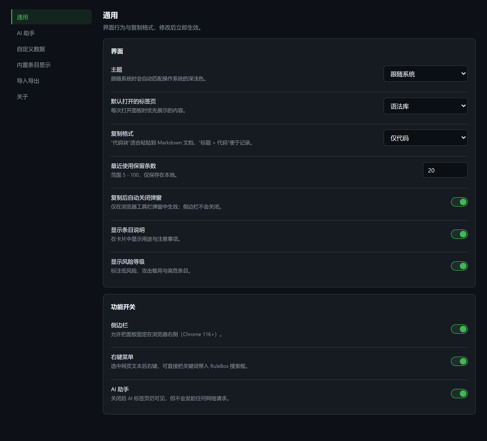
</p>

<br>

测绘查询分区：逐个平台填写 API Key，可点「测试连接」先校验连通性（截图中密钥已掩码显示）。

<p align="center">
  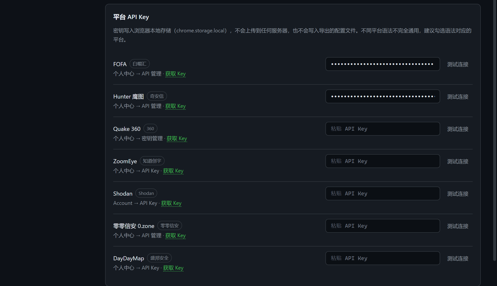
</p>

<br>

<details>
<summary><b>浅色主题预览</b>（点击展开）</summary>

<br>

#### 语法库 · 浅色

<p align="center">
  
</p>

<br>

#### Payload 库 · 浅色

<p align="center">
  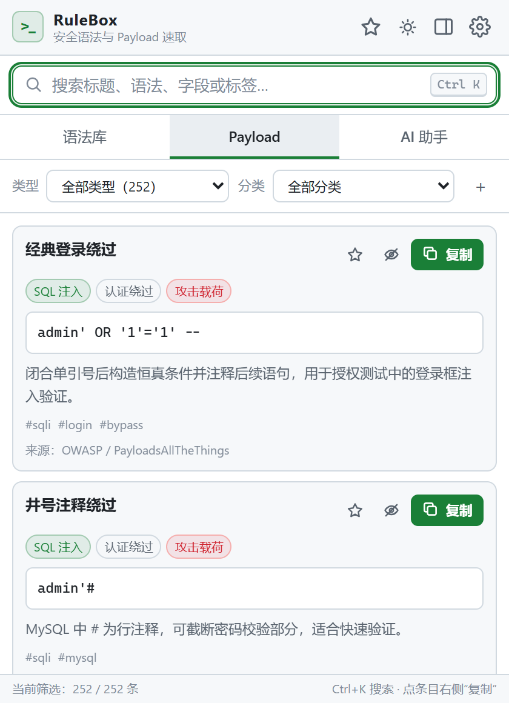
</p>

<br>

#### 聚合查询 · 浅色

<p align="center">
  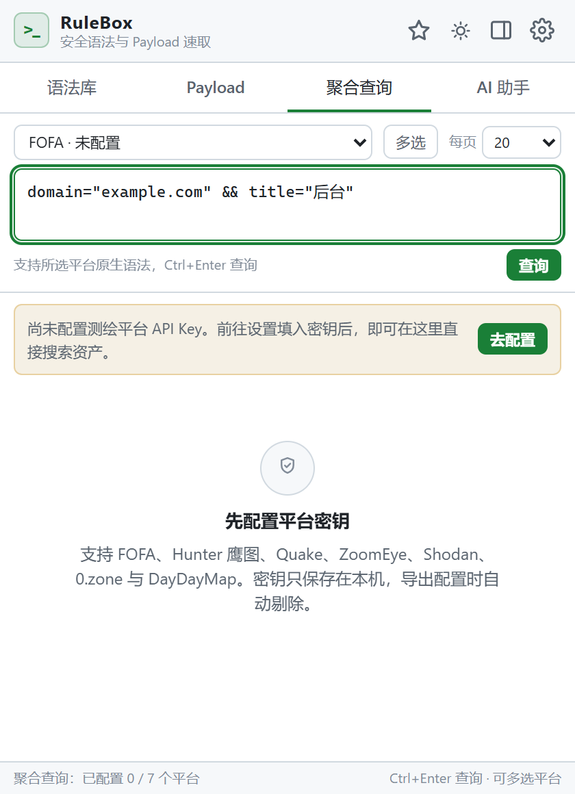
</p>

<br>

#### 变量填充 · 浅色

<p align="center">
  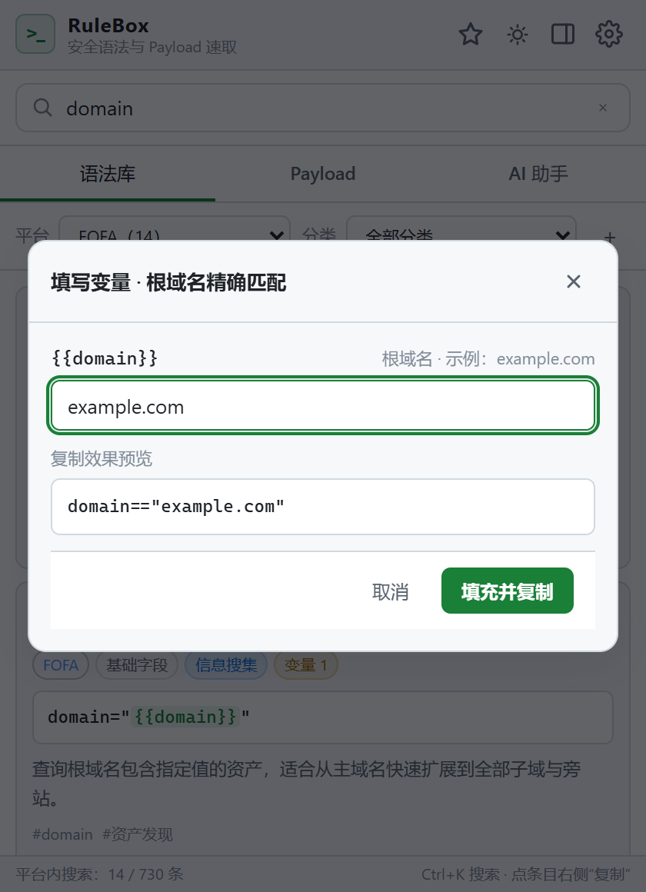
</p>

<br>

#### AI 助手 · 浅色

<p align="center">
  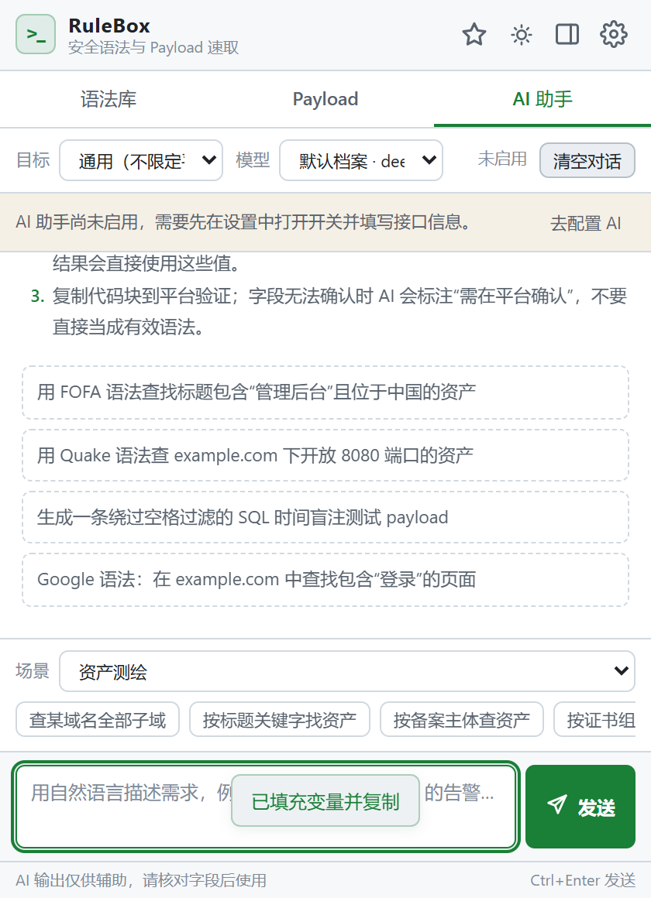
</p>

<br>

#### 设置页 · 浅色

<p align="center">
  
</p>

<br>

#### 测绘查询 · 浅色

<p align="center">
  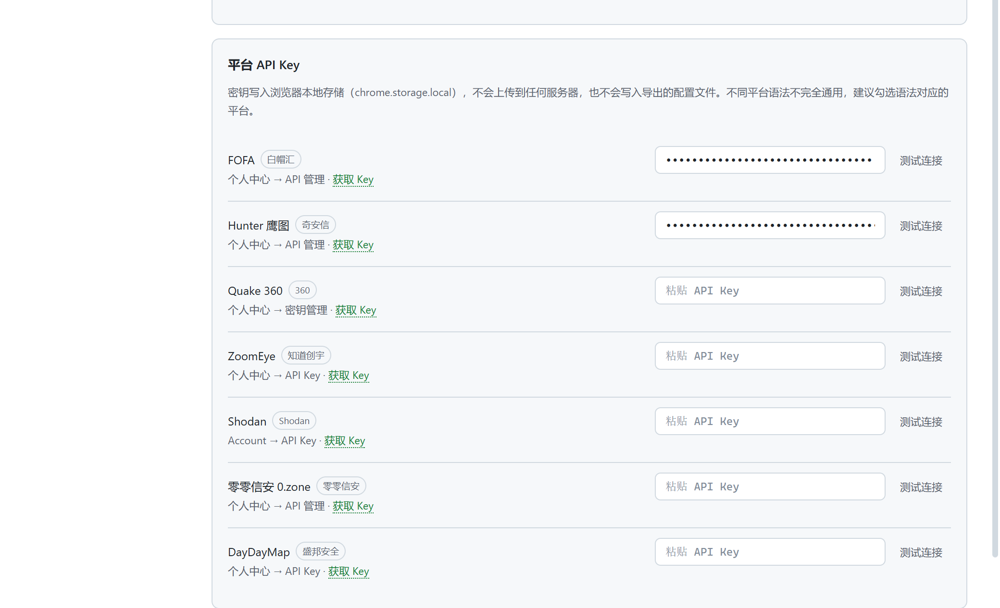
</p>

</details>

> 主题可在设置页切换：跟随系统 / 深色 / 浅色；也可点击面板右上角的主题按钮快速切换。

---

## 🚀 快速安装

本项目是标准的 Manifest V3 扩展，**无需构建、无需打包**，直接加载源码目录即可。

```bash
git clone https://github.com/EdenSec/RuleBox.git
```

也可以直接下载仓库 ZIP 后解压。

### Chrome

1. 打开 `chrome://extensions/`
2. 右上角打开「开发者模式」
3. 点击「加载已解压的扩展程序」，选择本项目根目录（包含 `manifest.json` 的目录）
4. 点击工具栏的拼图图标，把 RuleBox 固定到工具栏（可选，但建议固定，方便随时打开）

### Edge

1. 打开 `edge://extensions/`
2. 打开「开发人员模式」
3. 点击「加载解压缩的扩展」，选择本项目根目录（包含 `manifest.json` 的目录）
4. 点击工具栏的拼图图标，把 RuleBox 固定到工具栏

> Edge 与 Chrome 扩展的存储互不共用 — 同一份源码可以同时装进两个浏览器，设置、收藏、最近使用按浏览器隔离。

### 更新

- 通过 Git 使用：`git pull` 后，在扩展管理页点击 RuleBox 卡片上的刷新按钮
- 通过 ZIP 使用：重新下载并解压覆盖原目录，再点击刷新
- 如果界面没有变化，关闭并重新打开面板

---

<a id="shortcuts"></a>

## ⌨️ 快捷键

| 快捷键 | 功能 |
| :--- | :--- |
| `Ctrl+Shift+Y` / `Cmd+Shift+Y` | 打开 RuleBox 面板 |
| `Ctrl+K` / `Cmd+K` | 聚焦搜索框 |
| `Ctrl+1` / `2` / `3` / `4` | 切换 语法库 / Payload / 聚合查询 / AI 助手 |
| `Ctrl+Enter` | AI 输入框内发送请求；聚合查询中执行查询 |
| `Escape` | 清空搜索 / 关闭弹窗 |

> 如果 `Ctrl+Shift+Y` 与其它扩展冲突，可在 `chrome://extensions/shortcuts` 中修改。

---

## 🧭 功能一览

### 语法库 / Payload 库

- **多维筛选**：平台 → 分类 → 关键词，三级组合快速定位
- **变量填充**：`{{domain}}`、`{{ip}}`、`{{target}}` 这类占位符复制时弹窗填写，填过的值自动记忆
- **复制格式**：仅代码 / Markdown 代码块 / 标题 + 代码，设置页一键切换
- **存为文件**：WebShell 等 10 条样本支持填完变量后一键下载为文件，直接用于授权测试
- **收藏 / 最近使用**：高频条目收藏后只看收藏；最近 20 条自动记录（可在设置中调整）
- **隐藏内置条目**：暂时用不到的点眼睛图标隐藏，不删除任何数据；设置页可恢复
- **自定义条目**：筛选行的 `+` 可就地新增；自定义卡片支持直接编辑、删除，跟内置的一样用
- **右键搜索**：选中网页文本后右键「在 RuleBox 中搜索」，关键词直接带入
- **Wireshark 显示过滤**：内置 161 条显示过滤表达式，支持字段比较、逻辑组合、`contains` 与 `matches` 正则匹配，复制后直接粘贴到 Wireshark 过滤器栏；示例地址统一使用文档保留段与示例域名
- **默认标签页**：可跟随上次使用（默认），也可在设置里固定为语法库 / Payload / 聚合查询 / AI 助手，常用哪个就停在哪
- **侧边栏模式**：Chrome 116+ / Edge 116+ 固定常驻；低版本或侧边栏不可用时自动降级到弹窗 / 标签页

### 聚合查询（v2.0）

- **一个搜索框**：在面板内直接使用平台的原始语法检索，不必再逐个打开 FOFA / Hunter / Quake 等网站
- **平台选择**：默认是单选下拉，选一个平台直接查；需要同时查多个平台时点旁边的「多选」切换成复选面板
- **记住上次选择**：下次打开自动恢复上次用的平台；没有历史记录时优先选中已配置 Key 的平台，不会强行回到 FOFA
- **保留上次结果**：查询结果会存一份本地快照，点开结果跳转后重新打开面板仍能看到同一批结果（状态栏标注「上次查询」），不必为了复查再消耗一次额度
- **多平台并行**：切到多选后，同一语法会同时发往各平台，结果按平台分组展示
- **分页浏览**：每页 10 / 20 / 50 条可切换，上一页 / 下一页连续翻页
- **结果操作**：标题可直接在新标签页打开资产地址，右侧按钮一键复制地址
- **批量复制 / 导出**：结果状态行右侧提供「复制全部」（当前页所有资产地址，每行一条并去重，直接喂给扫描器或脚本）和「导出」，导出格式可选 JSON / CSV / Markdown / TXT：
  - **JSON**：保留语法、平台、页码与全部字段，方便二次处理
  - **CSV**：带 BOM，可直接用表格软件打开筛选
  - **Markdown**：表格形式，便于写报告或贴进文档
  - **TXT**：每行一条资产地址，最方便交给脚本或 AI
- **复制即查询**：在语法库复制测绘语法后，底部会出现「去查询」提示，一键带入聚合查询；可在设置 → 测绘查询中关闭此提示
- **密钥安全**：API Key 只保存在本机 `chrome.storage.local`，请求由扩展后台直接发往对应平台，导出配置时自动剔除
- **测试连接**：设置页每个平台都有「测试连接」，先用本地保存的 Key 校验一次，确认能打通再使用；FOFA / Shodan 走账号信息接口不消耗查询额度，其余平台只发一次最小探测（Hunter 受接口限制为 10 条，其他为 1 条），同一平台有 3 秒冷却

### AI 助手

- **自然语言生成**：「查询响应码为 200 的告警」→ 直接生成完整语法
- **提示词库**：内置 5 个场景、20 条提示词（资产测绘 / 暴露面排查 / 告警与研判 / Payload 定制 / 语法解释），也可以自己写
- **多供应商**：6 家预设 DeepSeek / 通义千问 / Kimi / 智谱 GLM / OpenAI / Ollama（本地），也支持任意 OpenAI 兼容端点
- **流式输出**：token 一个接一个出，不用等整批
- **本地召回示例**：请求前从库内检索最相关的少量条目作为参考，让生成风格贴近库内写法；只发送命中的少量示例，不上传全库
- **安全**：API Key 仅保存在本地 `chrome.storage.local`，请求时只发往你选择的供应商，导出配置时自动剔除；请求有域名授权、每日限额、最小间隔三重防护
- **错误即时提示**：额度不足、鉴权失败、限流等在对话里直接显示原因

### 深色终端风主题

- 深色 / 浅色 / 跟随系统三档
- 无渐变、无花哨装饰，信息密度高、长时间看不累
- 原生控件（下拉框等）随主题着色，深浅一致

---

<a id="cyber-config"></a>

## 🔎 测绘查询配置（可选）

1. 打开面板右上角「设置」→「测绘查询」
2. 在对应平台行填入 API Key（FOFA 个人中心、Hunter 个人中心、Quake 密钥管理、ZoomEye 个人中心、Shodan Account、0.zone 个人中心、DayDayMap 个人中心均可获取）
3. 回到面板「聚合查询」，选择平台（需要多平台时点「多选」）、输入语法即可查询
4. 不同平台语法不完全通用，例如 FOFA 的 `domain="example.com"` 与 Hunter 的 `domain="example.com"` 语义接近，但 Quake 使用 `domain: "example.com"`；建议只选择与语法匹配的平台
5. 填完 Key 可以点该行的「测试连接」：FOFA / Shodan 走账号信息接口，不消耗查询额度；其余平台会发起一次最小检索，消耗一次额度

**配额与计费**：查询会消耗各平台账号额度，RuleBox 不做任何中转或缓存，也不绕过平台限流；额度与频率限制以各平台账号为准。

---

## 🤖 AI 配置（可选）

1. 打开面板右上角「设置」→「AI 助手」
2. 打开「启用 AI 助手」总开关
3. 选择供应商（6 家预设：DeepSeek / 通义千问 / Kimi / 智谱 GLM / OpenAI / Ollama，或自定义任意 OpenAI 兼容端点），填入 API Key
4. 非内置域名端点首次使用需点击「授权域名」
5. 可调：模型、温度、超时、流式、历史条数、每日限额、系统提示词等

**接口异常时**：对话里立即显示错误原因与控制台入口；错误只在本机展示，不写入记录、不上传、不推送。

---

## 🔐 权限与隐私

RuleBox 没有后端服务，不上传语法库、Payload、收藏、历史，也没有遥测或统计上报。

| 权限 | 用途 |
| :--- | :--- |
| `storage` | 保存设置、收藏、最近使用、自定义条目 |
| `clipboardWrite` | 点击复制时写入剪贴板 |
| `contextMenus` | 提供「在 RuleBox 中搜索」右键菜单 |
| `sidePanel` | 侧边栏常驻模式 |
| `host_permissions` | 5 家内置 AI 服务、本地 Ollama 地址，以及 FOFA / Hunter / Quake / ZoomEye / Shodan / 0.zone / DayDayMap 的 API 域名 |
| `optional_host_permissions` | 自定义 AI 端点首次使用时按需申请，不授权则不发起请求 |

测绘查询的 API Key 与 AI Key 一样只保存在本机，不会发送给 RuleBox 作者或任何第三方中转；请求直接从扩展后台发往你选择的平台。导出配置时所有密钥都会被清空。

---

## ❓ FAQ

**数据保存在哪里？卸载会丢吗？**

设置、收藏、最近使用、自定义条目都保存在浏览器本地 `chrome.storage.local`。卸载扩展或清除扩展数据会丢失，建议定期在设置页导出配置备份。

**会把我的数据上传吗？**

不会。只有在你启用 AI 并主动发起请求时，才会把当前输入、对话历史和命中的少量示例发给你选择的 AI 供应商；不启用 AI、不使用聚合查询时，扩展不会向外部服务器发起请求。

**有 Chrome 应用商店版本吗？**

当前主要通过源码方式分发，方便审计、修改和二次开发；应用商店版本暂未提供。

**快捷键冲突怎么办？**

在 `chrome://extensions/shortcuts` 中修改。

**更新源码后要做什么？**

在扩展管理页点击 RuleBox 卡片上的刷新按钮；如果界面没有变化，关闭并重新打开面板。

**AI 必须配置吗？**

不必须。语法库、Payload 库、复制、收藏、自定义等核心功能完全离线可用。

**聚合查询必须配置吗？**

不必须，也不影响其它功能。未配置密钥时聚合查询页只做引导，不会发出任何请求。

**支持 Firefox / Safari 吗？**

当前仅支持 Chromium 系浏览器（Chrome / Edge 116+），未适配 Firefox / Safari。

---

## 🤝 帮助、反馈与贡献

- **遇到问题**：[提交 Issue](../../issues/new/choose)，尽量附上浏览器与扩展版本、复现步骤、控制台报错
- **想加语法 / Payload**：可以直接在面板或设置页新增，随加随用；也可以提 PR 修改 `src/data/` 下的 JSON（开发约定见 [docs/DEVELOPMENT.md](docs/DEVELOPMENT.md)）
- **提交代码前**：请先读 [DEVELOPMENT.md](docs/DEVELOPMENT.md)，保持无构建、纯原生 ES Module 的结构，不要在代码或数据里写入真实密码、Key、真实单位与个人的信息
- **贡献流程**：Fork → 新建分支 → 修改并本地加载验证 → 提交 PR；数据和代码贡献都欢迎

---

## 📖 数据来源与免责声明

- 语法与字段依据各平台**公开文档**与公开技术资料整理，条目内标注 `source` 来源；平台语法可能随官方改版而变化，欢迎纠错
- 奇安信天眼、安恒 AiLPHA、华为云安全云脑、深信服 SIP、长亭全悉、新华三 SecCenter CSAP 的字段与运算符依据公开技术资料/官方手册整理，不同版本、不同数据源的可检索字段存在差异，示例 IP 均为文档保留地址，实际以平台帮助文档为准
- Wireshark 语法依据官方显示过滤参考与公开文档整理，涉及 `tcp.analysis.*` 的条目需要开启 TCP 流分析；HTTPS 报文需配置 `SSLKEYLOGFILE` 或服务器私钥后才能用 `http.*` 字段解析；示例地址为文档保留段与示例域名
- 本插件提供语法与 Payload 的速查、复制、生成与样本导出能力，所有内容仅供**已授权的安全测试与防御研究**使用。使用者在未授权目标上使用相关内容所产生的一切后果自行承担。

---

## 🗂️ 目录结构

```
RuleBox/
├─ manifest.json              # MV3 清单
├─ LICENSE                    # MIT 开源协议
├─ icons/                     # 扩展图标（16/32/48/128）
├─ assets/                    # README 截图与动图
├─ src/
│  ├─ background/             # Service Worker（右键菜单 / 侧边栏 / 聚合查询）
│  ├─ core/                   # 核心逻辑（存储、数据、搜索、模板、AI、平台适配…）
│  ├─ data/                   # 内置 JSON 数据（平台 / 语法 / Payload / 提示词）
│  ├─ options/                # 设置页（HTML/CSS）
│  ├─ popup/                  # 弹窗与侧边栏（HTML/CSS）
│  ├─ shared/                 # 设计令牌与基础样式
│  └─ ui/                     # 界面逻辑（面板 / 设置页 / 组件库）
└─ docs/DEVELOPMENT.md        # 开发与维护文档
```

---

## 📜 License

本项目基于 [MIT License](LICENSE) 开源。

---

如果这个项目帮你省下了翻文档、拼 Payload 的时间，欢迎点一个 Star 支持一下。
